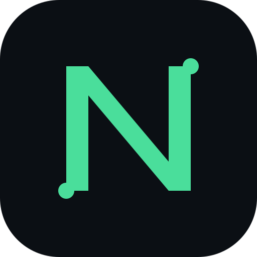
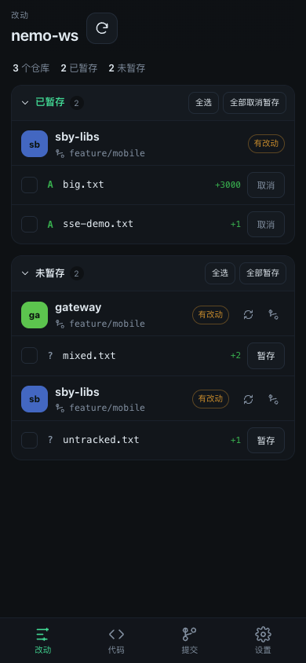
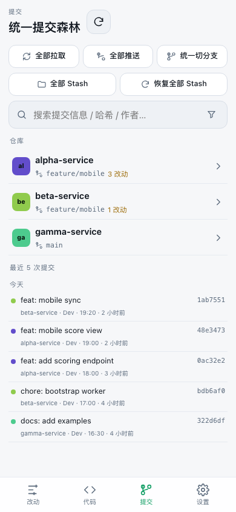
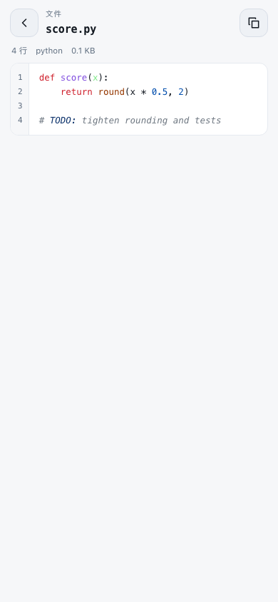

<div align="center">



# Nemorous Mobile

### 多仓如林 · 掌上俯瞰

**Nemorous 的手机端伴生控制台：多仓改动、Diff、统一提交与代码检索**<br>
Go 伴生服务 · React + Vite PWA · 单二进制内嵌前端 · 零运行时依赖（只需系统 `git`）

[](LICENSE)


**[快速开始](#快速开始)** &nbsp;·&nbsp; **[功能](#功能)** &nbsp;·&nbsp; **[安全不变量](#安全不变量)** &nbsp;·&nbsp; **[API](#http-api)** &nbsp;·&nbsp; **[来源与致谢](#来源与致谢)**

<br>

<picture>
  
  
  
</picture>

<sub>移动端实机视口 390 × 844：已暂存/未暂存分组、提交森林筛选、语法高亮代码查看。</sub>

</div>

<br>

## 为什么是“手机伴生”，而不是把桌面端搬上去

[Nemorous](https://github.com/iwangjie/Nemorous) 是基于 MyGo Native UI 的桌面工具，只提供 macOS / Windows / Linux 的 GPU 原生渲染；它的核心能力依赖桌面进程：`git` CLI、PTY 终端、`mani` 任务、AI Agent、临时 `git worktree` 合并。iOS 沙箱也不允许 App 派生子进程。

因此手机端不是“重新实现一个 Git”，而是把桌面工作区变成可远程操作的驾驶舱：**所有 Git 命令在电脑上执行，手机只负责界面与交互**。

| 传统多仓痛点 | Nemorous Mobile 的解法 |
| --- | --- |
| 离开电脑就无法审阅、暂存、提交 | 任意手机浏览器打开；可“添加到主屏幕”全屏运行 |
| 多个仓库逐个操作，容易漏掉 | 跨仓统一提交、全部拉取 / 推送、统一切分支 |
| 分不清哪些改动已暂存 | **已暂存 / 未暂存双分组**（对齐桌面 v0.2.1），各自批量操作 |
| 大 Diff 在手机上卡顿 | 独立 Diff 视口 + 窗口化渲染，3000 行 patch 只保留几十个 DOM 行 |
| 长 Token 放 URL 容易泄露 | 6 位配对码 → `HttpOnly` 会话 Cookie；设备可逐台撤销 |
| 操作后要手动刷新 | SSE 实时失效通知，所有已配对设备自动更新 |

---

## 功能

### 0. 多工作区

- 服务端记住多个工作区目录，手机在「设置 → 工作区」切换。
- 支持输入绝对路径添加已有工作区；勾选“目录不存在时创建”可创建空目录。
- 添加 / 切换后立即刷新；活动工作区在所有已配对设备间共享，并持久化到服务端。
- 工作区列表、活动工作区和每个工作区的隐藏仓库保存在状态目录的 `workspaces.json`，权限 `0600`。
- 「仓库可见性」可把某个项目从手机视图中排除；只影响发现与展示，不改仓库、改动或文件。

### 1. 改动：已暂存 / 未暂存双分组

- **双分组**：每个仓库的改动分成「已暂存」「未暂存」两组，可分别折叠；同一文件同时存在两侧时各出现一次。
- **批量操作**：分组级「全部暂存 / 全部取消暂存」「全选 / 取消全选」，文件级暂存切换。
- **分区快捷操作**：勾选文件后，「未暂存」标题右侧出现「暂存已选」；「已暂存」对应「取消暂存」，不需要切到底部提交栏。
- **Diff 路由正确**：点击已暂存文件对比 Index，点击未暂存文件对比 Worktree。
- **跨仓统一提交**：勾选任意仓库的文件，一次提交说明批量提交；可选提交后立即推送。
- **安全同步**：单仓拉取 / 推送；脏仓库的拉取与切分支会被安全跳过。
- **Stash 往返**：单仓或**全部仓库**暂存改动（含未跟踪文件）与恢复 Stash，不触碰 ignored 文件；统一切分支时可勾选“先 stash”。
- 文件状态、增删行数、冲突标记与仓库 health 一目了然。

### 2. 代码：零索引检索与查看

- 跨仓库文件名搜索（Git 索引）与内容搜索（优先 `rg`，未安装时内置扫描）。
- 仓库文件树、目录展开、路径过滤。
- 横屏文件阅读左侧显示文件目录，可展开 / 收起文件夹；目录右上角按钮可收起侧栏。
- 提交文件 Diff 在横屏同样显示「提交文件」目录树，当前文件高亮，可直接切换。
- 横屏目录边界可拖动调整宽度，宽度记忆；文件阅读、提交文件 Diff、工作区 Diff 通用。
- 侧栏文件树按扩展名显示类型徽标（Java / Kotlin / Go / XML / SQL / JS / TS / JSON / YAML / Markdown 等），并复用提交状态色。
- 全屏 / 沉浸模式下，左侧目录可通过浮动按钮打开；打开后收起按钮位于侧栏内，目录开关不退出全屏。
- 沉浸模式支持双指缩放：代码 / Diff 内容缩放字号；侧栏整体缩放目录、文件、图标、标题和间距，侧栏视觉宽度不变；结果持久化。
- 目录树内容宽度超过侧栏时可左右滑动，长路径不再被硬截断。
- 目录树默认全部展开；右上角提供「展开全部 / 收起全部文件夹」，目录行按 IDEA 风格压缩为 28px。
- highlight.js 语法高亮、行号、搜索命中行定位。
- **沉浸查看**：文件、单文件 Diff、完整 Patch 均可进入无顶栏 / 无底栏阅读；Android Chrome 会同时进入系统全屏以隐藏浏览器地址栏；右下角悬浮控件随时退出，`Esc` 也可退出。
- **代码字号**：文件顶栏 `Aa` 可直接打开字号面板；沉浸模式下 `A− / A+` 调整（6–22px），自动记忆；`+ / -` 快捷键同样可用。
- **Diff 语法高亮**：按文件语言逐行高亮，保留 IDEA 风格的改动词高亮。
- **Diff 字号**：工作区 Diff、提交文件 Diff、完整 Patch 同样支持 `Aa`，字号 6–20px，虚拟滚动行高同步缩放；底部工具栏放不下时，附加工具横向滚动，字号与展开按钮保持固定。
- **沉浸 Diff**：左上角单行浮条集中四向导航、字号 `A− / A+` 与退出；拖动 `⠿` 可放到任意位置，位置持久化，双击 `⠿` 复位；切换文件保持全屏。
- 二进制与超过 1 MiB 的文件明确提示，不静默截断。

### 3. 提交森林：搜索、筛选与详情

- 所有仓库的提交按时间合并成统一森林，按日分组。
- **搜索**：提交信息、完整/短哈希、作者（含邮箱）；RE2 正则、大小写开关。
- **筛选**：仓库、本地分支、只看我的提交（按仓库 `user.email`）、路径、最近 7/30/90 天。
- 分支与路径下推到 `git log`，旧历史也能命中；单次最多扫描每仓 1000 条。
- 提交详情：完整提交说明（标题 + 正文，自动换行）、作者、时间、哈希；可复制提交信息；变更文件按“仓库 → 目录 → 文件”树展示。
- 单文件 Diff：文件名在上、目录在下；底部是上一处 / 下一处、上一个 / 下一个文件，以及可展开的单栏 / 并排、查找、折叠、复制路径与打开文件工具；也支持键盘 `↑` / `↓`。
- 完整 Patch：按文件分节展示全部文件补丁，文件头显示状态、路径与增删行数，可单独折叠；顶部显示当前文件并可从文件列表跳转；整页虚拟滚动。
- 查看此版本：从单文件 Diff 打开该 commit 中的文件内容（只读）。
- 全部拉取 / 全部推送 / 所有仓库统一切分支，逐仓展示 `OK / SKIP / FAIL`。
- 单仓 `--amend`（仅未推送、单仓选择）与软撤销上一次未推送、非合并提交。
- **分支预设**：在设置里保存“仓库 → 分支”组合，在“统一切分支”弹窗一键应用；脏仓库仍跳过，分支不存在时逐仓报告。

### 4. 设备与安全

- 6 位配对码，10 分钟有效；过期自动轮换并打印到终端。
- 配对成功写入 `HttpOnly + SameSite=Lax` 会话 Cookie，页面脚本读不到凭证。
- 设备列表展示名称、最近活跃、加入时间；可逐台撤销，撤销立即失效。
- 同源写保护：Cookie 鉴权的写请求校验 `Origin` / `Sec-Fetch-Site`。
- 可选 `-token` 仅供脚本使用 `Authorization: Bearer`；手机端不使用长令牌。

---

## 安全不变量

- **绝不强制推送**：任何路径都不会出现 `--force` / `--force-with-lease`。
- **脏仓库跳过**：拉取、切分支前检查未提交改动，直接 `SKIP`，不 stash、不覆盖。
- **丢弃必须确认**：UI 二次确认 + 服务端 `confirm:true` 双重校验。
- **提交只含选中文件**：`git commit -- <paths>`，不会把其他已暂存内容带入。
- **改写有边界**：`--amend` 与软撤销只允许未推送、未打标签的提交；合并提交不能撤销。
- **路径隔离**：仓库相对路径做规范化与 symlink 逃逸检查，禁止访问 `.git`。
- **命令可控**：`GIT_TERMINAL_PROMPT=0`，读操作 15s、写操作 120s 超时。
- **会话安全**：会话令牌只存 SHA-256；配对码按 IP 限制失败次数；请求体上限 1 MiB。

> 一台已配对设备等同于工作区写权限。只在可信网络（家庭 / 公司内网 / Tailscale）中启动服务，不要把端口直接暴露到公网；手机丢失时在设置页立即撤销。

---

## 快速开始

```bash
# 1. 构建前端（会从 Go 类型生成 web/src/types.ts）
cd web
npm install
npm run build

# 2. 构建单二进制（内嵌前端）
cd ..
go build -o nemorous-mobile .

# 3. 指向你的多仓工作区
./nemorous-mobile -workspace ~/code
```

终端会打印：

```text
Nemorous Mobile 0.3.41
工作区: /Users/you/code（6 个仓库）
配对码: 123456（19:42 前有效）
手机打开: http://192.168.1.5:8787/?pair=123456
```

手机与电脑处于同一网络后打开该链接即可自动配对；也可以在任意页面手动输入配对码。需要用二维码时，把终端里的链接交给任意二维码工具生成后再用手机扫描。配对成功后 Cookie 自动保存，地址栏里的配对码会被移除。

### 安装到手机（全屏运行）

Chrome 只会在 **HTTPS 安全上下文**提供安装入口。局域网 `http://<IP>:8787` 可以正常浏览，但无法安装，也不会隐藏浏览器地址栏。

推荐用 Tailscale Serve 把本机服务放到 HTTPS：

```bash
tailscale serve --bg 8787
# 手机访问 https://<机器名>.<tailnet>.ts.net
```

手机与电脑都登录同一个 tailnet 后：

- Android Chrome：地址栏右侧出现安装图标，或在「设置 → 安装到手机」点击安装；也可以 Chrome 菜单 →「安装应用 / 添加到主屏幕」
- iPhone Safari：分享 →「添加到主屏幕」
- 安装后以 standalone 独立窗口运行，不再显示地址栏，并可横竖屏旋转；未安装时可在设置里使用「临时全屏显示」

HTTPS 下 Service Worker 会自动注册，用于离线壳与后续推送能力。

### 参数

| 参数 | 默认值 | 说明 |
| --- | --- | --- |
| `-workspace` | 当前目录 / `$NEMOROUS_WORKSPACE` | 工作区根目录；根本身是仓库时只服务该仓库，否则扫描直接子目录 |
| `-addr` | `:8787` | 监听地址 |
| `-token` | 空 | 可选的 API Bearer 令牌（脚本 / curl）；也可用 `$NEMOROUS_TOKEN`；手机端不使用 |
| `-state` | `os.UserConfigDir()/nemorous-mobile` | 配对设备状态目录（`devices.json`） |
| `-web` | 空（使用内嵌资源） | 开发时从指定目录提供前端 |

配对设备保存在状态目录的 `devices.json`，权限 `0600`；只存会话令牌的 SHA-256。

### 开发

```bash
go generate ./internal/app          # 从 Go AST 重新生成 web/src/types.ts
go test ./...                       # 后端测试（真实 git 夹具）
go run . -workspace /tmp/nemo-ws    # 后端 :8787

cd web
npm run dev                         # Vite 开发服务器，/api 代理到 :8787
npm run build                       # 生成类型 + 类型检查 + 生产构建
```

---

## HTTP API

所有 `/api/*`（除 `health` 和 `POST /api/pair`）都需要已配对会话 Cookie，或可选的 API Bearer 令牌。

| 方法 | 路径 | 作用 |
| --- | --- | --- |
| GET | `/api/health` | 版本探活（无鉴权） |
| POST | `/api/pair` | 用 6 位配对码换取会话 Cookie |
| GET | `/api/pair/code` | 当前配对码与过期时间（已配对设备） |
| GET | `/api/devices` | 已配对设备列表 |
| DELETE | `/api/devices/{id}` | 撤销设备；撤销当前设备会清除 Cookie |
| GET | `/api/events` | SSE：`invalidate` 事件，客户端据此重新拉取 |
| GET | `/api/workspace` | 全部仓库状态与改动文件 |
| GET | `/api/repos/{id}` | 单仓状态 + 本地/远端分支 |
| GET | `/api/repos/{id}/diff?path=&staged=` | 单文件统一 Diff |
| GET | `/api/repos/{id}/files` | 跟踪 + 未跟踪文件列表 |
| GET | `/api/repos/{id}/file?path=&rev=` | 工作区或指定版本文件内容 |
| GET | `/api/repos/{id}/commits?limit=` | 单仓提交 |
| GET | `/api/repos/{id}/commits/{hash}` | 提交详情与补丁 |
| GET | `/api/commits?limit=&q=&regex=&case=&repo=&branch=&author=&mine=&path=&days=` | 全仓合并提交森林，支持搜索与筛选 |
| GET | `/api/branches` | 各仓库本地分支（提交筛选用） |
| GET | `/api/search?q=&mode=files\|content&regex=&case=&repo=` | 跨仓搜索 |
| POST | `/api/repos/{id}/stage` · `unstage` · `discard` | 文件操作 |
| POST | `/api/repos/{id}/commit` | 单仓提交 |
| POST | `/api/repos/{id}/push` · `pull` | 单仓同步 |
| POST | `/api/repos/{id}/checkout` | 切换 / 新建分支 |
| POST | `/api/repos/{id}/stash` · `/stash/pop` | 暂存 / 恢复改动（含未跟踪） |
| POST | `/api/repos/{id}/undo` | 软撤销上一次未推送、非合并提交 |
| POST | `/api/batch` | `pull` / `push` / `fetch` / `checkout` 批量执行 |
| POST | `/api/batch/commit` | 跨仓统一提交 |
| POST | `/api/batch/stash` · `/api/batch/stash/pop` | 多仓批量 Stash / 恢复 |
| GET | `/api/presets` | 当前工作区的分支预设 |
| POST | `/api/presets` | 保存 / 覆盖“仓库 → 分支”组合 |
| POST | `/api/presets/delete` | 删除预设 |
| POST | `/api/presets/apply` | 应用预设（脏仓库跳过） |

仓库 `id` 为绝对路径的 SHA-1 前 12 位，刷新后保持稳定。

---

## 目录结构

```text
.
├── main.go                 # 嵌入前端、配对码、静态服务
├── internal/app
│   ├── git.go              # 仓库发现、status 解析、健康度
│   ├── ops.go              # diff / 暂存 / 提交 / 推送 / 分支 / 搜索
│   ├── auth.go             # 配对码、设备会话、Cookie、限流
│   ├── events.go           # SSE invalidate 广播
│   ├── server.go           # 路由、鉴权、CORS、请求体
│   ├── types.go            # API DTO（生成 TS 类型的源头）
│   ├── gentypes/           # Go AST → web/src/types.ts
│   └── app_test.go         # 真实 git 夹具集成测试
└── web
    ├── src
    │   ├── App.tsx         # 路由、SSE 实时刷新、配对
    │   ├── api.ts          # 请求、配对、主题
    │   ├── types.ts        # Go 生成的 API 类型（勿手改）
    │   ├── views/          # 改动 / 代码 / 提交 / 设置 / Diff
    │   └── styles.css      # 移动优先主题
    └── public              # PWA manifest、图标、service worker
```

---

## 来源与致谢

- 源自 [**iwangjie/Nemorous**](https://github.com/iwangjie/Nemorous)（MIT，Copyright © 2026 iwangjie）：多仓 Git 协同的产品概念、交互模型、统一提交/合并工作流与安全不变量来自该桌面项目。
- 已对齐桌面 **v0.2.1** 的「已暂存 / 未暂存」分组与批量操作；提交森林的搜索/筛选维度也对齐桌面筛选条。
- 原桌面端基于 [**egoist/mygo**](https://github.com/egoist/mygo)（MIT）构建，仅支持 macOS / Windows / Linux；本项目未复用 MyGo，手机端为独立的浏览器 PWA。
- 本项目为独立实现，**未复制原项目源代码**；Go 伴生服务与 TypeScript 客户端均为新增代码，按 MIT 发布。完整声明见 [NOTICE.md](NOTICE.md)。

---

## 已知限制

- **不做手机端编辑保存**：代码查看器只读；行级微调、终端、AI 合并、`mani` 任务仍留在桌面端。
- **不做 worktree 合并 / AI 冲突消解**：桌面端的合并与 6 项 `VerifyAIMerge` 校验属于重事务操作，移动端暂不提供。
- 多仓批量 amend 尚未提供；当前 amend 按单仓操作。分支预设只保存分支名，不保存 commit SHA。
- 提交筛选最多扫描每仓 1000 条历史后再合并。
- 拉取只使用 `--ff-only`，不做桌面端的 stash / pop 自动恢复。
- Web Push 未实现：需要 HTTPS + 已安装 PWA + VAPID；当前仅提供 SSE 实时刷新。
- Capacitor 原生壳未打包：同一套 `web/dist` 可包成 iOS / Android 应用，但需要 Xcode 签名、Android SDK 与商店配置。
- 会话 Cookie 只支持同源；反向代理时需要 HTTPS + 同源部署。
- 局域网 HTTP 下浏览器不提供 PWA 安装入口；安装与锁屏通知都需要 HTTPS。
- 文件查看上限 1 MiB、文件树 20000 条、高亮 4000 行；文件查看器只读，不支持手机端编辑保存。
- 客户端检测到服务端版本变化后会提示刷新，但不会自行下载、替换或重启电脑端二进制；自动升级仍需部署层实现。
- 设备会话默认 365 天有效；撤销设备会立即失效，但当前没有应用锁或更短的自动过期策略。
- 添加工作区会让所有已配对设备访问该路径下的 Git 仓库；只添加可信目录，不要把包含敏感仓库的父目录整体加入。
- Diff 默认单栏 Unified；并排视图已提供，但手机竖屏通常需要横向滚动，横屏 / 平板体验更好。
- iOS 不允许后台常驻服务：手机是客户端，电脑端必须在线。

---

## License

MIT。本项目代码版权归 Nemorous Mobile contributors；上游来源与致谢见 [NOTICE.md](NOTICE.md)。
